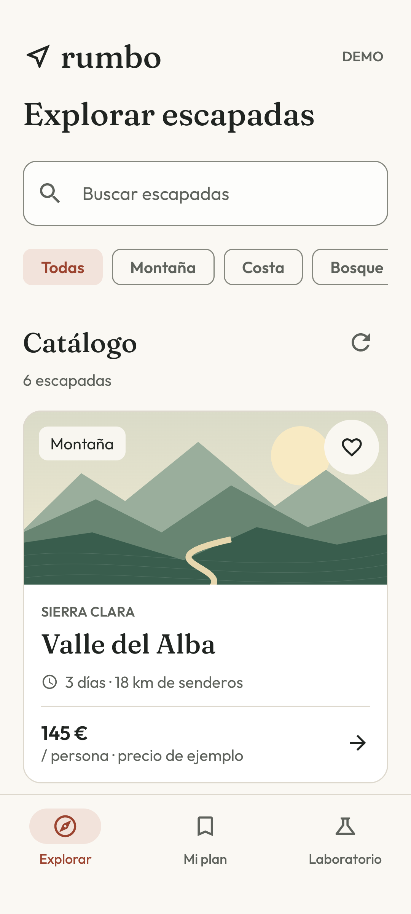
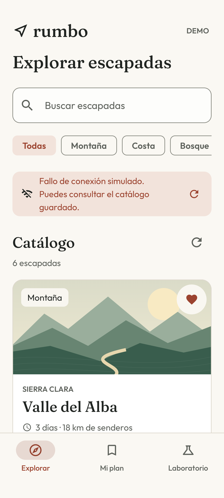

# Rumbo

[English](README.md) · [Compilación y pruebas](https://github.com/navalcode/rumbo-android/actions/workflows/checks.yml)

Aplicación Android para explorar seis escapadas ficticias, guardar favoritos y conservar reservas de ejemplo en el dispositivo. Si falla una actualización, el catálogo guardado sigue disponible.

Usa Kotlin, Compose, Navigation, Room y Retrofit, con la lógica de dominio en un módulo core separado. Los destinos y precios son inventados; una reserva de ejemplo no reserva un viaje real. No necesita cuenta, clave de API ni backend, y no tiene permiso de Internet.

<p>


</p>

## Qué puedes probar

1. Busca por título o región, con o sin acentos, y filtra por categoría.
2. Abre una escapada. El corazón guarda un favorito sin confundir esa acción con abrir el detalle.
3. Pulsa **Añadir reserva de ejemplo**. Consulta la reserva y tus favoritos en **Mi plan**. Repetir la reserva conserva su referencia original.
4. En **Laboratorio**, selecciona Sin conexión, Error del servicio o Respuesta lenta y vuelve a Explorar. Un fallo de actualización conserva el catálogo guardado.
5. Selecciona **Carga correcta** en Laboratorio para recuperar. Reinicia el proceso para comprobar favoritos y reservas guardados.

Los escenarios cambian las respuestas locales, no la conexión del dispositivo. Para probar el primer arranque sin datos guardados, utiliza una instalación nueva de la demo y el argumento de escenario. Sustituye `DEVICE_ID` por el serial del dispositivo:

```sh
adb -s DEVICE_ID shell am start -n dev.navalcode.rumbo/.MainActivity --es demo_scenario OFFLINE
```

Valores: `CONNECTED`, `OFFLINE`, `SERVICE_ERROR`, `SLOW`. Solo cambia la fuente de esta demo.

## Ejecutar

Necesitas **JDK 17**, **Android SDK 36** y un emulador o dispositivo con **API 26 o superior**. Abre el proyecto en Android Studio o configura la ruta del SDK en un `local.properties` sin versionar:

```properties
sdk.dir=/ruta/al/Android/sdk
```

Desde esta carpeta:

```sh
./gradlew :core:test :app:testDebugUnitTest :app:lintDebug :app:assembleDebug
./gradlew :app:installDebug
./gradlew :app:connectedDebugAndroidTest
./gradlew :app:assembleRelease
```

Las pruebas conectadas necesitan un emulador o dispositivo. Los [comandos de verificación](docs/VERIFICATION.md), en inglés, explican cómo elegir un serial y obtener capturas opcionales. `:app:bundleRelease` genera un AAB. Release activa R8 y reducción de recursos; no hay firma de producción configurada.

Gradle 8.14.3 está fijado con SHA-256; AGP 8.13.2, Kotlin 2.2.10 y las bibliotecas usan versiones concretas. Las dependencias proceden de Google Maven y Maven Central.

## Por dónde leer el código

- [Trips.kt](core/src/main/kotlin/dev/navalcode/rumbo/core/Trips.kt): contratos de fuente y almacenamiento, límite de espera, cancelación, caché y reservas idempotentes, sin dependencias de Android.
- [TripCatalogApi.kt](app/src/main/java/dev/navalcode/rumbo/data/TripCatalogApi.kt): validación de DTO de Retrofit y tratamiento de fallos HTTP/I/O.
- [TripDatabase.kt](app/src/main/java/dev/navalcode/rumbo/data/TripDatabase.kt): reemplazo transaccional del catálogo y reservas únicas con Room.
- [TripsViewModel.kt](app/src/main/java/dev/navalcode/rumbo/ui/TripsViewModel.kt): flows de solo lectura, entradas del usuario y cancelación de una actualización sustituida por otra.
- [RumboApp.kt](app/src/main/java/dev/navalcode/rumbo/ui/RumboApp.kt): Compose, destinos de Navigation, detalle por ID y acciones locales.
- [Landscape.kt](app/src/main/java/dev/navalcode/rumbo/ui/Landscape.kt): ilustraciones Canvas originales.

[Arquitectura](docs/ARCHITECTURE.md), en inglés, explica el pequeño grafo manual de dependencias, las alternativas y los límites de restauración. [DESIGN.md](DESIGN.md) recoge el diseño y las fuentes empaquetadas.

## REST sin backend

Retrofit declara `GET /v1/trips` en `https://demo.rumbo.invalid/`. Un interceptor de aplicación OkHttp responde localmente sin reenviar las peticiones. El escenario selecciona una respuesta, fallo I/O, HTTP 503 o espera cancelable. El repositorio aplica un límite de 3,5 segundos y conserva catálogo y fecha anteriores ante los fallos esperados.

Las pruebas con MockWebServer usan HTTP real en loopback para comprobar contrato y cancelación. La fuente de viajes está simulada. Consulta y categoría se conservan al recrear la actividad mediante el ViewModel, pero no tras morir el proceso; los datos de Room persisten por separado.

## Comprobaciones y límites

El proyecto tiene **32 pruebas JVM** (16 de core, 10 HTTP y seis de ViewModel) y **ocho Android** de Room, reserva, caché, Atrás, favorito independiente y recreación de actividad. [Verificación](docs/VERIFICATION.md) registra ejecuciones, capturas, auditorías de artefactos e intentos fallidos. El enlace de CI superior lleva a los resultados alojados.

Los recursos están en español con inglés de respaldo. Es un ejemplo formativo: sin disponibilidad real, pagos, firma de producción ni distribución en tiendas. Las pruebas de emulador y las comprobaciones de layout no acreditan comportamiento físico ni una certificación formal de accesibilidad.

## Licencia

Código, documentación e ilustraciones originales: [MIT](LICENSE), Manuel Naval, 2026. Los [avisos de terceros](THIRD_PARTY.md) conservan los de Gradle y las dependencias.
