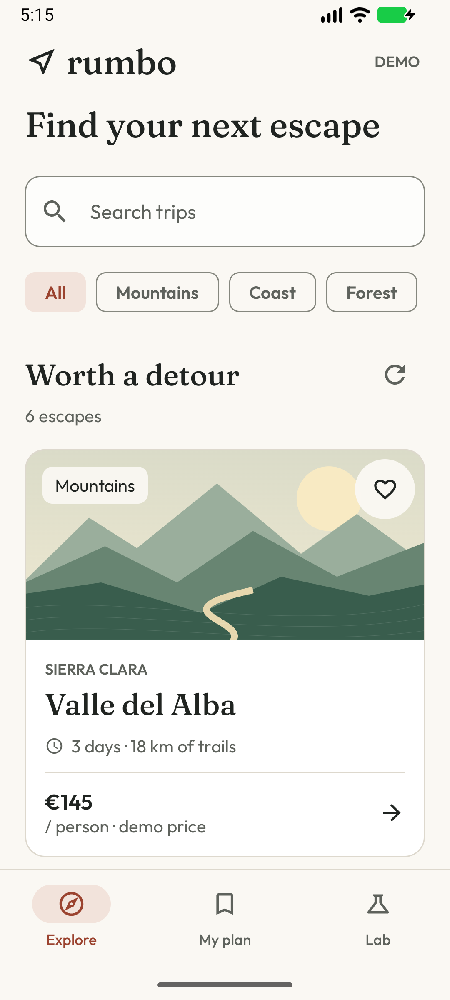
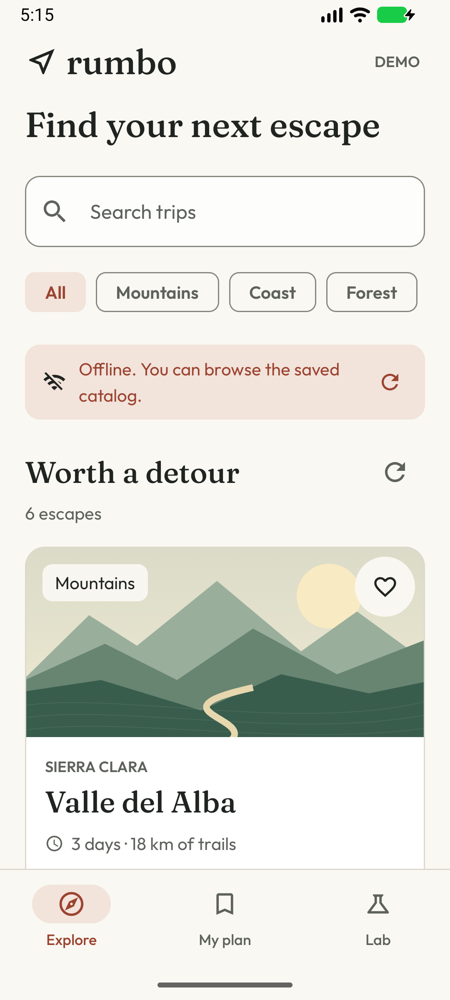

# Rumbo

[Español](README.es.md) · [](https://github.com/navalcode/rumbo-android/actions/workflows/checks.yml)

An original Android app for exploring fictional trips and inspecting mobile engineering behavior: cached data, REST adaptation, immutable presentation state, cancellation, navigation and local persistence.

All catalog entries, regions, prices and bookings are fictional. No production service, account or API key is needed. The app requests no permissions and collects no personal data. Favorites and demo bookings stay on the device.

| Explore | Keep reading cached content |
|---|---|
|  |  |

## Try the app

1. Explore six trips. Search by title or region, with or without accents.
2. Filter by mountain, coast or forest.
3. Open a detail, save a favorite and make a local demo booking.
4. Find saved trips and bookings in My plan.
5. In Lab, select Offline, Service error or Slow response.
6. Return to the catalog: failed refreshes preserve cached content. Restore Connected to recover.
7. Restart the app to inspect persisted favorites and bookings. System Back returns from a detail to its previous destination.

Offline mode changes the fictional transport, not the device's connectivity. To test a first load without a cache, use a clean installation and start with:

```sh
adb shell am start -n dev.navalcode.rumbo/.MainActivity --es demo_scenario OFFLINE
```

Allowed values: `CONNECTED`, `OFFLINE`, `SERVICE_ERROR`, `SLOW`. This argument only configures the original demo fixture.

## Interface design

[DESIGN.md](DESIGN.md) records the visual decisions. A compact introduction leads to labelled search, filters and trips; the favourite action is independent of opening a detail. Outfit serves reading/controls and Fraunces supports destination headings, with bundled OFL notices. Recovery banners are announced as live regions. The actual captures show the redesigned app, not generated mockups.

## Build and run

Requires JDK 17, Android SDK 36 and a device/emulator with API 26 or newer. Open this directory in Android Studio, or configure the SDK in an untracked `local.properties`:

```properties
sdk.dir=/path/to/Android/sdk
```

From this directory:

```sh
./gradlew :core:test :app:testDebugUnitTest :app:lintDebug :app:assembleDebug
./gradlew :app:installDebug
./gradlew :app:connectedDebugAndroidTest
./gradlew :app:bundleRelease
```

Connected tests require a device. Gradle 8.14.3 is pinned with a distribution SHA-256; AGP 8.13.2, Kotlin 2.2.10 and library versions are explicit. Google Maven and Maven Central supply dependencies. Release has R8 and resource shrinking enabled; production signing is intentionally not configured.

## Read the code

| Boundary | Files and behavior |
|---|---|
| Domain and orchestration | [`Trips.kt`](core/src/main/kotlin/dev/navalcode/rumbo/core/Trips.kt): source/store contracts, refresh deadline, cancellation, cache and booking idempotence. No Android dependency. |
| REST adapter | [`TripCatalogApi.kt`](app/src/main/java/dev/navalcode/rumbo/data/TripCatalogApi.kt): Retrofit, DTO validation, HTTP/I/O failure mapping and intercepted fixture responses. |
| Persistence | [`TripDatabase.kt`](app/src/main/java/dev/navalcode/rumbo/data/TripDatabase.kt): Room, transactional replacement and booking uniqueness. |
| Presentation | [`TripsViewModel.kt`](app/src/main/java/dev/navalcode/rumbo/ui/TripsViewModel.kt): read-only flows, user-input methods, combined state and replacement cancellation. |
| Interface | [`RumboApp.kt`](app/src/main/java/dev/navalcode/rumbo/ui/RumboApp.kt): Compose, Navigation destinations, ID-based detail and local actions. |
| Original artwork | [`Landscape.kt`](app/src/main/java/dev/navalcode/rumbo/ui/Landscape.kt): Canvas illustrations. |

The app uses manual injection because its graph is small. [Architecture and decisions](docs/ARCHITECTURE.md) explain alternatives, ownership, restoration and validation limits.

## How REST works without a backend

Retrofit declares `GET /v1/trips` against `https://demo.rumbo.invalid/`. An OkHttp application interceptor answers every request locally and never forwards it. A demo header selects success, offline I/O or HTTP 503; slow mode adds a cancellable delay. The app has no Internet permission and opens no network connection.

Separate MockWebServer tests exercise real loopback HTTP, serialization, path/header behavior, failed responses and cancellation. This demonstrates a client against an original fictional contract. It does not claim integration with a production travel API.

The repository applies a 3.5-second source deadline. A failure preserves the previous catalog and timestamp. A replacement refresh cancels the earlier one. Repeated local bookings preserve their reference and original date. Query/filter changes use cached data. Navigation and Room own route and data persistence; query/category are not restored after process death.

## Verification and limits

Validated locally on 29 October 2026:

- **32 JVM tests:** 16 core, 10 HTTP adapter and six ViewModel tests.
- **Eight API 37 emulator tests:** three Room checks and five Compose journeys cover booking, cached offline content, Back, route restoration and an independent favourite action that persists after activity recreation. The redesigned suite passed at 360 × 800 logical pixels; the earlier seven checks also passed at 1080 × 1920 / 440 dpi.
- **Lint:** no errors; dependency/target upgrade notices remain.
- **Release:** the redesigned APK builds with R8 and resource shrinking. An AAB and a locally test-signed cold-cache release were validated before this visual revision. Production signing is not configured.
- **Advisory artifact audit:** 2.48 MB DEX with 16 KB native/ZIP alignment. The tool warns that R8 rate metadata is absent; it cannot measure shrinking/optimization/obfuscation percentages from this APK. This is not store approval.

The GitHub Actions workflow builds/tests/lints the app and has a separate API 35 emulator job. Follow the workflow link above for current results; a checked-in workflow alone is not a passing run.

UI resources are Spanish and English. Current native visual checks cover both languages at 360 × 800 and English text scaling 1.5, including a scrollable detail. No physical-device validation, formal accessibility certification, real availability, payments or store distribution is claimed.

## License

Original code, documentation and artwork: [MIT](LICENSE), copyright 2026 Manuel Naval. See [third-party notices](THIRD_PARTY.md) for the Gradle wrapper and dependencies.
