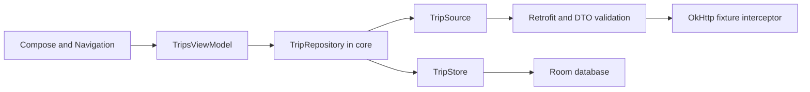

# Architecture and engineering decisions

Rumbo is a self-contained Android portfolio app. All trips, regions, prices and bookings are fictional. Its boundaries are small enough to read without requiring accounts or a backend.

## State and ownership

`TripsViewModel` exposes read-only flows. Query and category changes use methods and filter cached data without starting requests. The combined state uses `WhileSubscribed(5000)`. Collection in Compose follows the lifecycle. An initial refresh starts in `viewModelScope`; a replacement refresh cancels the previous job. No worker belongs to a composable's incidental recomposition.

The repository owns the 3.5-second source deadline and serializes refreshes with a mutex. It propagates caller cancellation, distinguishes its own deadline from an outer timeout, and retains cached data on expected source failures. Unexpected programming/storage failures are not silently relabeled as network failures. The small manual dependency graph avoids an extra DI framework; the source and storage contracts support fakes and alternate adapters.

## REST boundary

`TripCatalogApi` declares `GET /v1/trips`. Retrofit 3.0.0 and Gson decode DTOs separately from domain models. Required fields, category, value bounds, duplicate IDs and null items are validated before replacing the catalog. HTTP errors and invalid contracts map to unavailable; transport I/O maps to offline. Coroutine cancellation propagates to the Retrofit call.

The shipped app uses `https://demo.rumbo.invalid/`, a deliberately invalid host. An application interceptor handles **every** request and never calls `chain.proceed`. The `X-Demo-Scenario` header selects a fictional response, offline I/O failure or HTTP 503. Slow mode uses a cancellable coroutine delay. The app has no Internet permission and never opens a network connection. This makes the same app reproducible offline.

MockWebServer tests exercise actual loopback HTTP requests, paths, headers, deserialization, HTTP errors and cancellation in JVM tests. They prove client behavior against a fictional contract, not compatibility with a production backend. Adding a real service would require a separately reviewed environment, HTTPS configuration, authentication and privacy scope.

## Navigation and persistence

Navigation Compose owns the Explore, Plan, Lab and `trip/{tripId}` destinations. Details pass only a stable ID and resolve it from cached state. The detail page supports system Back. Top-level destinations use single-top navigation and saved-state restoration. A device test recreates the activity while a detail is open and checks restoration.

Room holds the catalog, timestamp, favorite IDs and local bookings. Catalog replacement is transactional. Booking uniqueness is enforced in storage and coordinated by a repository mutex; repeating an operation returns the existing reference and date. This is local idempotence, not payment or server transaction processing. Backup is disabled for the demo database.

Query/category state survives configuration changes through the ViewModel, but it is not restored after process death. Room data survives process restart. The Navigation restoration test covers activity recreation, not a physical device or all process-kill scenarios.

## Quality and release

Core tests use fakes and virtual time. ViewModel tests inspect loading, replacement cancellation, failure/cache/recovery and user actions. HTTP tests cover the adapter, and emulator tests cover Room and navigation/reservations. Lint and optimized release builds are separate checks: neither proves runtime behavior by itself. A locally signed optimized APK is used for a fresh-cache runtime smoke check.

The UI has Spanish/English resources, icon action labels, headings, minimum touch targets and scrolling detail content. Initial visual checks used both languages and enlarged text. These checks are not a formal accessibility certification. CI uses an API 35 emulator; local device tests used an API 37 emulator. No physical-device or store validation is claimed.
